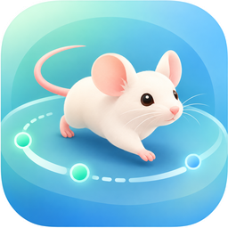
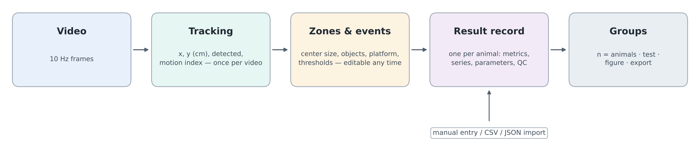
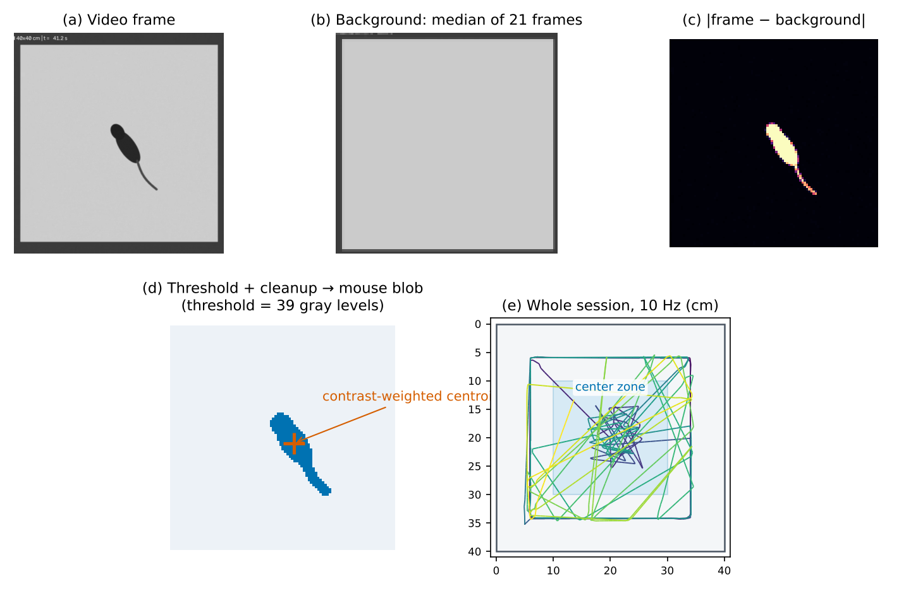

<p align="center">
  
</p>

<h1 align="center">RodentFlow</h1>

<p align="center">
  Rodent behavior tracking and analysis on iPhone: video tracking, manual scoring, table import and group statistics, all on the device.<br>
  在 iPhone 上完成啮齿类动物行为的视频追踪、评分与组间统计。
</p>

<p align="center">
  <a href="https://seesaw-earth.github.io/RodentFlow/">Website</a> ·
  <a href="https://seesaw-earth.github.io/RodentFlow/guide/introduction.html">User manual</a> ·
  <a href="https://seesaw-earth.github.io/RodentFlow/zh/guide/introduction.html">中文手册</a> ·
  <a href="https://seesaw-earth.github.io/RodentFlow/principles/tracking.html">How tracking works</a> ·
  <a href="https://seesaw-earth.github.io/RodentFlow/principles/validation.html">Validation</a>
</p>

<p align="center">
  
  
  
  
</p>

---



## What it does

- **Video tracking on the phone.** Ten assays from a top-down video: open field, elevated plus maze, light–dark box, Y-maze, T-maze, novel object recognition, Morris water maze, Barnes maze, fear conditioning (freezing) and conditioned place preference. The whole recording is read at 10 samples per second.
- **Calibrated arenas and mazes.** Positions in centimeters through a 4-point perspective calibration (rectangle), circle calibration, or maze centerlines (plus, Y, T).
- **One result per animal.** Every video, manual entry or imported row becomes a result. Zones and thresholds can be changed afterwards without tracking again.
- **Manual entry and import** for all 15 assays, including marble burying, sucrose preference, beam walking, gait and a two-armed bandit with a Q-learning fit. Accepts CSV, TSV and JSON, with English or Chinese column names.
- **Group statistics that fit the design.** n = animals. Welch's t, Mann–Whitney, ANOVA + Tukey–Kramer, Kruskal–Wallis + Dunn, mixed ANOVA with Greenhouse–Geisser, paired and one-sample tests, with effect sizes. Each test was checked against SciPy, pingouin and scikit-posthocs (1,059 checks).
- **Private by design.** No account, no network code, no analytics. Everything stays on the iPhone until the user shares it.
- **English and Simplified Chinese.**

The tracker is a classic, transparent pipeline: temporal-median background with repair for a resting animal, adaptive threshold, candidate scoring, and a contrast-weighted centroid. There is no neural network. Every step is documented in the [manual](https://seesaw-earth.github.io/RodentFlow/principles/tracking.html).



## Build from source

Requirements: a Mac with **Xcode 15 or later** (the project was created with Xcode 16) and an iPhone with **iOS 17 or later**. There are no third-party dependencies.

```bash
git clone https://github.com/seesaw-earth/RodentFlow.git
cd RodentFlow
open RodentFlow.xcodeproj
```

In Xcode:

1. Select the **RodentFlow** target › **Signing & Capabilities**, and choose your own **Team**. A free Apple ID works for running on your own iPhone.
2. Change the **Bundle Identifier** to one of your own, e.g. `com.yourname.rodentflow`. `com.ziqingshi.rodentflow` belongs to the published app.
3. Choose your iPhone as the run destination and press **Run** (⌘R).

## Repository layout

```text
RodentFlow.xcodeproj/        Xcode project (iOS 17+, iPhone)
RodentFlow/                  App source (SwiftUI)
  NativeMouseTracker.swift     background, threshold, candidate scoring, centroid, arena mapping, motion index
  FullVideoAnalyzer.swift      sequential 10 Hz decoding of the whole video with checkpoints
  AssayEngine.swift            zones, entries, distance, freezing and all video metrics
  ManualAssays.swift           manual-entry assays and the two-armed bandit / Q-learning fit
  StatsEngine.swift            statistics (t, F, χ², studentized range, exact rank tests, mixed ANOVA)
  GroupAnalysis.swift          test selection by design, n = animals
  DataImport.swift             CSV / TSV / JSON import and column matching
  Localizable.xcstrings        English and Simplified Chinese strings (~1,000)
  PrivacyInfo.xcprivacy        privacy manifest (no tracking, no collected data)
SampleData/                  synthetic example tables for the import and the Groups tab
Tools/localization/          scripts that check the string catalog
docs/                        user manual website (VitePress, English and Chinese)
dev-notes/                   design, build, localization and test notes
CHANGELOG.md                 release notes
```

## User manual website

The manual at https://seesaw-earth.github.io/RodentFlow/ is built from `docs/` with [VitePress](https://vitepress.dev/) and deployed by `.github/workflows/deploy.yml` whenever something under `docs/` changes on `main`.

```bash
npm ci
npm run docs:dev      # live preview at http://localhost:5173/RodentFlow/
npm run docs:build    # production build; fails on broken internal links
```

## Contributing

Bug reports, assay requests and pull requests are welcome. See [CONTRIBUTING.md](CONTRIBUTING.md). For questions about using the app, see the [FAQ](https://seesaw-earth.github.io/RodentFlow/reference/faq.html) or open an [issue](https://github.com/seesaw-earth/RodentFlow/issues).

## Citing

If RodentFlow contributes to published work, please cite it. GitHub's **Cite this repository** button uses [CITATION.cff](CITATION.cff).

## License

[MIT](LICENSE) © 2026 Ziqing Shi

---

## 中文简介

RodentFlow 是一款 iPhone App，覆盖啮齿类动物行为实验从视频到组间统计的全过程：

- 十种实验范式可以直接用俯拍视频追踪：旷场、高架十字迷宫、明暗箱、Y/T 迷宫、新物体识别、Morris 水迷宫、Barnes 迷宫、恐惧条件化、条件性位置偏好；
- 15 种实验范式都支持手动录入和表格导入，列名中英文均可；
- 以动物为单位，按实验设计自动选择统计检验，生成显示每只动物数据点的图表；
- 不联网、无账号，所有数据只在手机上。

**从源码构建**：用 Xcode 15 或更高版本打开 `RodentFlow.xcodeproj`，在 Signing & Capabilities 中选择自己的 Team，把 Bundle Identifier 改成自己的（如 `com.yourname.rodentflow`），连接 iPhone（iOS 17+）运行即可，没有第三方依赖。

使用手册：https://seesaw-earth.github.io/RodentFlow/zh/ · 许可证：MIT
